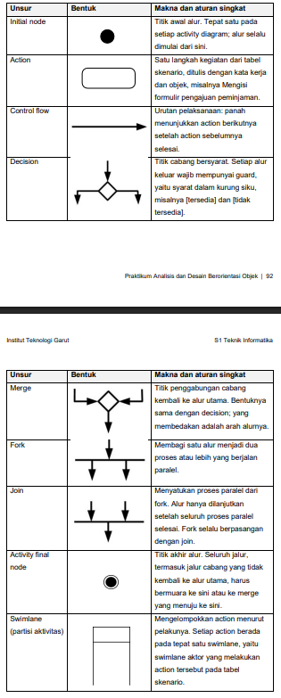

# Laporan Pertemuan 6: Activity Diagram - Dari Skenario ke Alur Aktivitas

## A. Tujuan Pembelajaran

Setelah mengikuti praktikum, mahasiswa mampu:

1. Menyusun alur utama sebuah *activity diagram* dari Skenario Normal pada tabel skenario Pertemuan 5, dengan tepat satu *initial node*, *action* yang berurutan mengikuti langkah skenario, dan tepat satu *activity final node*, tanpa alur yang terputus.
2. Mengubah Skenario Alternative pada tabel skenario menjadi cabang *decision* dengan *guard* yang lengkap dan benar, lalu mengembalikan cabangnya ke alur utama melalui *merge* atau mengakhirinya pada jalur akhir yang jelas.
3. Menggunakan *fork* dan *join* sebagai pasangan untuk dua proses yang berjalan paralel, dengan *join* yang menyatukan kembali kedua proses sebelum alur dilanjutkan.
4. Mengelompokkan setiap *action* ke dalam *swimlane* yang sesuai dengan aktor pada tabel skenario, sehingga tanggung jawab setiap *action* terbaca dari partisinya.
5. Menelusurkan setiap *action* pada *activity diagram* ke langkah tabel skenario Pertemuan 5 yang menjadi sumbernya, dan memeriksa hasil akhir dengan *checklist* penilaian sebelum berkas dikumpulkan.

## B. Teori atau Prinsip Dasar Praktikum

*Activity diagram* adalah diagram UML yang memodelkan alur kegiatan sebuah proses: urutan *action*, percabangan keputusan, proses yang berjalan paralel, dan pembagian tanggung jawab antar pelaku.

Satu *activity diagram* mempunyai tepat satu *initial node* dan minimal satu *activity final node*. Setiap *decision* mempunyai *merge* pasangannya (kecuali berakhir di *final node*), dan setiap alur keluarnya wajib berlabel *guard* dalam kurung siku (contoh: `[tersedia]`). *Fork* selalu berpasangan dengan *join* untuk proses paralel. *Action* ditempatkan pada *swimlane* aktor yang melakukannya sesuai tabel skenario.

Unsur activity diagram menurut OMG UML 2.5.1 diringkas pada tabel berikut.
Kesembilan unsur ini adalah seluruh kosakata gambar yang dipakai pada
pertemuan ini.
****

## C. Hasil Praktikum

### 1. Studi Kasus Laboratorium (LAB)

Pada studi kasus utama, pemodelan tujuh *activity diagram* yang mewakili *use case* utama sistem peminjaman laboratorium telah dilakukan. Secara keseluruhan, pemodelan telah mematuhi aturan diagram UML, di mana setiap diagram memiliki tepat satu *initial node* dan diakhiri dengan *activity final node*.

Rincian pemodelan ketujuh diagram tersebut adalah sebagai berikut:

* **Activity Lihat Ketersediaan Peralatan:** Memodelkan alur baca sederhana antara Peminjam dan Sistem dengan percabangan status ketersediaan peralatan.
* **Activity Kelola Data Peralatan:** Merupakan diagram kompleks yang menggabungkan beberapa *use case*. Alur utama mengelola data, dengan titik *decision* yang membagi alur menjadi tiga varian operasi: Tambah, Ubah, dan Hapus. Titik ini disatukan kembali menggunakan *merge* sebelum penyimpanan data.
* **Activity Ajukan Peminjaman:** Melibatkan *swimlane* Mahasiswa, Sistem, dan Petugas Laboratorium. Diagram ini mencakup *action include* wajib yaitu "Periksa Ketersediaan" serta *decision* perpanjangan (*extend*) untuk konfirmasi pencetakan bukti.
* **Activity Cetak Bukti Pengajuan:** Memodelkan perilaku *extend* secara utuh, dimulai langsung dari status "Menunggu Keputusan" dengan percabangan konfirmasi pencetakan oleh mahasiswa.
* **Activity Proses Keputusan Peminjaman:** Dikerjakan secara mandiri, memodelkan logika Petugas Laboratorium dalam memeriksa kelayakan pengajuan dan menetapkan status disetujui atau ditolak, beserta respon Sistem terkait.
* **Activity Pengembalian Peralatan:** Diagram ini mendemonstrasikan penggunaan *fork* dan *join*. Saat petugas melakukan pengecekan, alur dipecah menjadi dua proses paralel: "Periksa Kondisi Peralatan" dan proses baru "Periksa kelengkapan aksesori peralatan". Kedua proses ini disatukan dengan *join* sebelum memicu *decision* akhir.
* **Activity Lihat Laporan Peminjaman:** Diagram khusus untuk aktor Kepala Laboratorium yang fokus pada alur pemilihan periode dan validasi ketersediaan data laporan.

### 2. Studi Kasus Sistem Informasi Akademik (SIA)

Sebagai tugas mandiri yang dievaluasi, *Activity Diagram* komprehensif untuk proses akademik, yaitu dari Input Nilai Mata Kuliah sampai Lihat KHS, telah disusun berdasarkan skenario SIA-UC08 dan SIA-UC09.

Implementasi diagram ini mencakup kriteria wajib berikut:

* **Penggunaan Empat Swimlane:** Alur dibagi secara terstruktur melintasi kolom Dosen, Sistem, Admin Akademik, dan Mahasiswa.
* **Penerapan Decision dan Merge (Iterasi Kelengkapan Nilai):** Setelah Dosen memasukkan nilai dan Sistem menyimpannya, terdapat *decision* pengecekan "Nilai sudah lengkap". Jika nilai `[belum lengkap]`, alur dikembalikan (*feedback loop*) ke *swimlane* Dosen untuk diperbaiki, lalu disatukan kembali melalui *merge* sebelum diteruskan ke Admin Akademik untuk disahkan.
* **Penerapan Fork dan Join (Proses Paralel Sistem):** Setelah nilai disahkan oleh Admin Akademik, Sistem melakukan publikasi hasil studi. Pada tahap ini, alur dipecah menggunakan *fork* menjadi dua *action* paralel: "Menerbitkan KHS pada portal akademik" dan "Mengirim pemberitahuan hasil studi kepada mahasiswa". Alur tersebut kemudian disatukan dengan *join* sebelum Mahasiswa melakukan aksi akhir yaitu "Melihat KHS".

## D. Kesimpulan

Melalui praktikum ini, dokumen naratif (tabel skenario) berhasil dipetakan menjadi diagram alur yang logis dan sesuai dengan standar UML 2.5.1. Penggunaan *swimlane* memperjelas batas tanggung jawab antara aktor manusia dan sistem. Selain itu, praktik menggunakan *decision-merge* untuk kondisi alternatif dan *fork-join* untuk aktivitas simultan telah memperkuat pemahaman dalam memodelkan logika sistem yang kompleks menjadi rancangan visual yang siap diimplementasikan.
